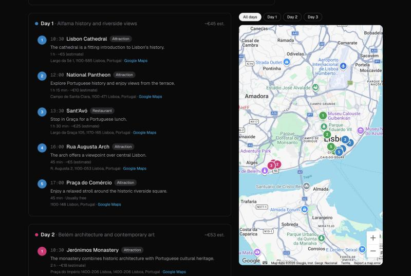
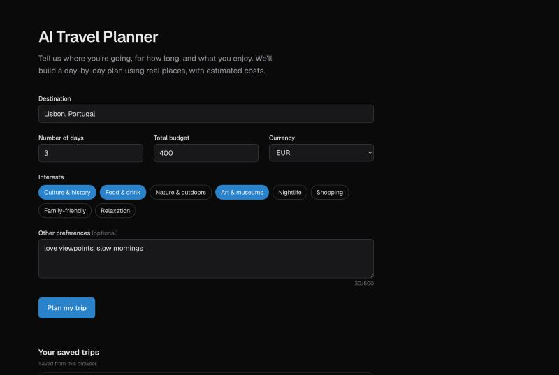
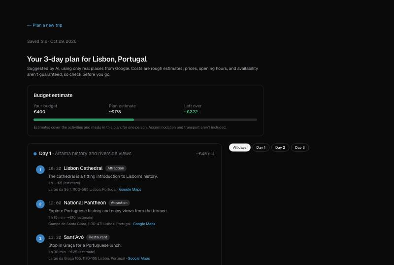
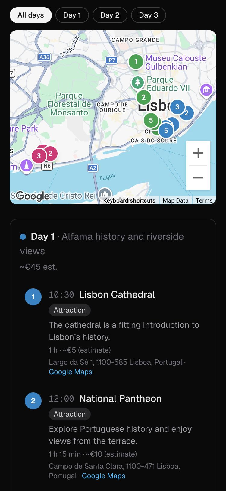

# AI Travel Planner

Plan a day-by-day trip using **real places**. Enter a destination, trip length,
budget, and interests; the app finds real attractions and restaurants with
Google Places, has an AI organize **only those places** into a schedule, shows
everything on a map, estimates costs, and lets you save the plan as a private
link.

> **Live demo:** _coming soon (deploying to Vercel)_
>
> **Learn how it was built:** a step-by-step course in [`docs/course/`](docs/course/README.md), one module per milestone.



## The problem

AI chatbots can write a lovely itinerary — and confidently include restaurants
that closed years ago or never existed. This app keeps the AI for what it's
good at (organizing, explaining) and takes the facts from a real data source:

1. **Google Places** returns real candidate places (with IDs and coordinates).
2. **OpenAI** arranges them into days — and is technically unable to output a
   place that isn't on the list.
3. **Code**, not the AI, does all the math and checks the result.

## Features

- **Trip form** — destination, 1–14 days, budget, currency, interests,
  optional preferences; accessible validation messages.
- **Real places** — attractions and restaurants from Google Places, restricted
  to the destination's area. Unknown destinations get a clear message.
- **AI itinerary** — time slots, reasons, durations, and cost estimates,
  generated with OpenAI structured outputs. The response schema only accepts
  this request's real place IDs.
- **Interactive map** — day-colored numbered markers; click a stop to find it
  on the map, or a marker to find it in the list; filter by day.
- **Budget summary** — per-day and total estimates vs. your budget, computed
  in code and clearly labeled as estimates.
- **Saved trips** — save a plan to a private, unguessable link; reopen it on
  any device. "Your saved trips" lists the ones saved in this browser.
- **Useful states** — loading with time expectations, errors with retry where
  it helps, "not enough places" instead of made-up filler.
- **Responsive** — list + sticky map on desktop, stacked on phones.

| Trip form | Budget estimate | Phone |
|---|---|---|
|  |  |  |

## Tech stack

| Area | Technology |
|---|---|
| Framework | Next.js 16 (App Router, Route Handlers, Cache Components), React 19, TypeScript |
| Styling | Tailwind CSS 4 |
| Validation | Zod 4 (shared by browser and server) |
| Places | Google Places API (New) — Text Search |
| AI | OpenAI Responses API with structured outputs (`gpt-6.1-terra` by default) |
| Map | Google Maps JavaScript API via `@vis.gl/react-google-maps` |
| Database | Supabase (PostgreSQL) |
| Tests | Vitest |
| Hosting | Vercel |

## Architecture

```
Browser (React)                         Server (Next.js Route Handlers)
───────────────                         ───────────────────────────────
TripForm ──► TripPlanner ──fetch──►  POST /api/itinerary
                                        1. validate (Zod) · rate limit
                                        2. Google Places: find destination area,
                                           search per interest + restaurants
                                        3. too few places? → 422, no AI call
                                        4. OpenAI: schema with enum of real IDs
                                        5. code: dedupe, sort, copy names from
                                           Google data, validate, sign (HMAC)
ItineraryView ◄── plan + signature ──┘
  ├─ BudgetSummary (math in code)
  ├─ TripMap (public browser key)
  └─ SaveTripPanel ──fetch──►        POST /api/trips
                                        verify signature · rate limit · insert
/trips/[id] (server-rendered) ◄────── Supabase (RLS on, secret key server-only)
```

Key folders:

```
app/                 pages, /trips/[id], and API routes
components/          UI (TripForm, TripPlanner, ItineraryView, TripMap, …)
lib/ai/              OpenAI client, prompt, structured output, checks
lib/google-maps/     Google Places search
lib/schemas/         Zod schemas (single source of truth for data shapes)
lib/itinerary/       budget math, day colors
lib/trips/           save/load, signatures, per-browser saved list
lib/supabase/        server-only Supabase client
supabase/migrations/ SQL to create tables and functions
docs/course/         the course
```

## Security

- Secret keys (Google Places, OpenAI, Supabase secret, signing secret) are
  **server-only**; a production-bundle scan finds none of them in browser code.
- The only public key (Maps JavaScript) is restricted to this site's domains
  and one API.
- All input is validated on the server; request bodies are size-limited.
- Generated plans are **HMAC-signed**, so only unmodified, server-made plans
  can be saved.
- Supabase tables have **Row Level Security on with no policies** — only the
  server can read or write.
- **Rate limits** (stored in Supabase): 10 plans/hour per visitor, 200/day
  overall, 30 saves/hour per visitor. Visitor IPs are stored only as hashes.
- Security headers (nosniff, frame denial, strict referrer policy).

## Getting started

Requirements: Node.js 22+, npm, and accounts for Google Cloud, OpenAI, and
Supabase.

```bash
git clone https://github.com/alizaaiter27/ai-travel-planner.git
cd ai-travel-planner
npm install
cp .env.example .env.local   # then fill in real values
npm run dev                  # http://localhost:3000
```

### Environment variables

| Variable | Public? | Where to get it |
|---|---|---|
| `GOOGLE_MAPS_API_KEY` | Server only | Google Cloud → Credentials; restrict to **Places API (New)** |
| `NEXT_PUBLIC_GOOGLE_MAPS_API_KEY` | **Public** | Google Cloud → a second key; restrict to **Maps JavaScript API** and your websites |
| `OPENAI_API_KEY` | Server only | platform.openai.com → a dedicated project with a budget |
| `OPENAI_MODEL` | Server only | Optional; defaults to `gpt-6.1-terra` |
| `SUPABASE_URL` | Server only | `https://<project-ref>.supabase.co` |
| `SUPABASE_SECRET_KEY` | Server only | Supabase → Project Settings → API Keys (`sb_secret_…`) |
| `TRIP_SIGNING_SECRET` | Server only | `openssl rand -hex 32` |

Never put a secret in a `NEXT_PUBLIC_` variable, and never commit `.env.local`.

### Google Cloud

Enable **Places API (New)** and **Maps JavaScript API**. Create two keys:
a server key (API restriction: Places API (New); no application restriction)
and a browser key (website restriction: `http://localhost:3000/*` plus your
deployed domain; API restriction: Maps JavaScript API). Set daily quotas and a
budget alert. Details: [Module 06](docs/course/06-google-places-key.md),
[Module 12](docs/course/12-map.md).

### Supabase

Create a project, then run each file in `supabase/migrations/` (in order) in
the dashboard's **SQL Editor**. Details: [Module 13](docs/course/13-saving-trips.md),
[Module 14](docs/course/14-hardening.md).

## Testing

```bash
npm test          # unit tests (budget math, signatures, request size limits)
npm run lint
npx tsc --noEmit  # type check
npm run build     # production build
```

Manual and failure-case testing (broken keys, rate limits, tampered saves,
phone layout) is described in [Module 14](docs/course/14-hardening.md).

## Deployment

Deployed on Vercel: import the GitHub repository, add the environment
variables above in **Project → Settings → Environment Variables**, deploy,
then add the Vercel domain to the browser Maps key's allowed websites.
The itinerary route sets `maxDuration = 200` seconds for slow AI responses.

## Limitations

- Costs are **rough AI estimates** for one person (activities and meals only);
  prices, opening hours, and availability are not checked.
- Travel times between stops aren't calculated; nearby stops are grouped by
  address.
- Plans can only use places Google returns for up to 3 interests (plus
  restaurants) — small towns may have too few places for long trips.
- Saved trips are "anyone with the link" — there are no user accounts yet.
- A missing saved trip shows "Trip not found" with HTTP 200 (a side effect of
  streaming).
- Rate limits are per IP, so people sharing a network share a limit.

## License

Not yet licensed — all rights reserved by the author.
